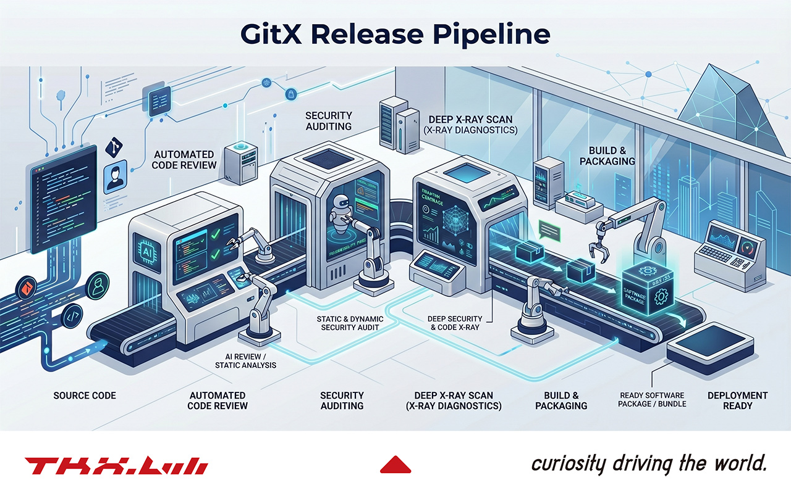
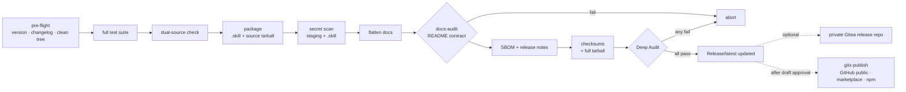

<!-- Hero image docs/assets/release-demo.jpeg is hand-maintained, not generated. Regions marked gitx:managed are regenerated by scripts/docs-pipeline.sh. -->
<div align="center">

# 🚀 GitX — Fail-Closed Release Pipeline for AI Agent Skills

**Every release rule is a shell assertion that stops the build — so what reaches your users is exactly what was tested, scanned and audited.**

<!-- gitx:managed:badges -->
[](LICENSE)
[](tests/run_all.sh)
[](scripts/release-audit.sh)
[](#4-quick-start)
[](SKILL.md)
[](https://github.com/tkxlab-ai/GitX/releases)
[](docs/JOURNEY.md)
<!-- /gitx:managed:badges -->

[English](README.md) · [中文](README_CN.md)

<p align="center">
  
</p>

</div>

> 🔄 **One install, four agent CLIs.** GitX runs inside Claude Code, Codex, OpenCode and Gemini, and releases any project laid out as `skills/<name>/SKILL.md`. Most release incidents are not code bugs — a version bumped in one file but not another, a README that no longer matches the code, a token in a public archive, a tarball nobody can rebuild. GitX turns that checklist into one local command, and GitX itself is released with GitX.

<!-- gitx:managed:build-metrics -->
> 🛠 **Build metrics** — Version **v1.16.0** · Released **2026-11-18** · Engineered with **Claude (Opus/Sonnet) · Codex · Gemini** across hundreds of sessions · Cumulative AI tokens since the first prototype (v0.9.4, 2026-04-22), estimated: **≈ 300M+ input/output + ≈ 3B+ cached**
<!-- /gitx:managed:build-metrics -->

**[Documentation](#table-of-contents) · [Changelog](CHANGELOG.md) · [Report a bug](https://github.com/tkxlab-ai/GitX/issues) · [Security](SECURITY.md)**

**Install**

```text
# Claude Code — plugin marketplace
/plugin marketplace add tkxlab-ai/marketplace
/plugin install gitx@tkxlab
# upgrade: /plugin → enable auto-update, or `claude plugin update gitx@tkxlab`
```

```bash
# Codex — plugin marketplace
codex plugin marketplace add tkxlab-ai/marketplace
codex plugin add gitx@tkxlab
# upgrade: codex plugin marketplace upgrade, then codex plugin add gitx@tkxlab again
```

```bash
# OpenCode — npm plugin (install without a version so update checks work)
opencode plugin add @tkxlabai/gitx-opencode
# upgrade (inside a project directory): opencode plugin update
```

```bash
# Everything else, or one install for several CLIs — Codex, OpenCode and Gemini CLI also read ~/.agents/skills
git clone --depth 1 https://github.com/tkxlab-ai/GitX.git && bash GitX/install.sh
# upgrade: add --force
```

Pick one install method per agent — two methods load two copies of the skill.

Then run it: Claude Code `/gitx-release` (plugin: `/gitx:release`) · Codex `$gitx-release` (the plugin lists it as `gitx:gitx-release`) · OpenCode `@gitx-release` · Gemini CLI: ask for "gitx release". Details in [Quick Start](#4-quick-start).

---

## What's New

<!-- gitx:managed:whats-new -->
**v1.16.0 — 2026-11-18**

- Codex plugin: `codex plugin marketplace add tkxlab-ai/marketplace`, then `codex plugin add gitx@tkxlab`; upgrade with `codex plugin marketplace upgrade` and `codex plugin add gitx@tkxlab` again.
- OpenCode plugin: `opencode plugin add @tkxlabai/gitx-opencode` (no version pin, so update checks work); upgrade with `opencode plugin update`, run inside a project directory. The npm package contents are a fixed whitelist: `opencode/` and `skills/gitx-release/`.
- `scripts/gitx-publish.sh --version vX.Y.Z`, run after the GitHub draft is approved: it checks everything first (the draft's assets byte-for-byte against `Release/`, GitHub `main`'s `VERSION`, the npm package's name, version and contents), then makes the GitHub Release public and keeps Latest on the highest version, bumps the central marketplace (`.gitx/marketplace-target`) and publishes the npm package (`.gitx/npm-target`). A failure stops at that step; rerunning the same command skips the steps already done. `--dry-run` checks without writing. npm accepts each version only once: a version re-cut after its npm publish needs a new version number.
- The README install block lists Claude Code, Codex, OpenCode and `install.sh`, each with its upgrade command, and says to pick one install method per agent (two methods load two copies). The release page standard (row 9) and the README templates carry the same blocks.
- The central marketplace bump moved out of `gitx-release` into `gitx-publish.sh`. This applies to every project with `.gitx/marketplace-target`: the marketplace is bumped when the release goes public, never before. `gitx-release --skip-marketplace` is still accepted and does nothing.
- Central marketplace entries use a `url` source (`https://github.com/<owner>/<repo>.git`), which both Claude Code and Codex install from; `gitx-marketplace bump` migrates an old `github` entry.
<!-- /gitx:managed:whats-new -->

Full history → [`CHANGELOG.md`](CHANGELOG.md).

---

## Table of Contents

1. [Why GitX](#1-why-gitx)
2. [Philosophy](#2-philosophy)
3. [Pipeline & Audit Gates](#3-pipeline--audit-gates)
4. [Quick Start](#4-quick-start)
5. [Command Surface](#5-command-surface)
6. [Configuration](#6-configuration)
7. [Testing](#7-testing)
8. [Security](#8-security)
9. [Compatibility](#9-compatibility)
10. [FAQ](#10-faq)
11. [Research & References](#11-research--references)
12. [Contributing](#12-contributing)
13. [License](#13-license)

---

## 1. Why GitX

A release is a checklist, and every item on it can be skipped by accident. Each skipped item becomes an incident later:

| Release step | What goes wrong without a gate | How GitX stops it |
|---|---|---|
| Version bump | the version file and the version being released disagree | the pre-flight stage aborts unless `VERSION` equals the release version |
| Changelog | the release ships with a missing or placeholder entry | the changelog gate requires a real entry for this exact version |
| Tests | "it passed on my machine last week" | the full suite runs again inside the pipeline; one failure aborts |
| Packaging | the bundle users install is not the tree that was tested | `scripts/` and the bundled copy must be byte-identical |
| Secrets | a token or a home-directory path lands in the public archive | a scanner checks the staging tree and the unpacked `.skill` for credentials, user paths, emails, public IPs, MAC addresses and key fingerprints |
| Docs | README numbers and sections drift away from the code | generated README regions are compared with the code; drift fails the release |
| Integrity | nobody can tell whether a download was altered | `checksums.txt` covers every shipped file; `install.sh` verifies it when installing from a release download |
| Publishing | private hostnames or working notes leak into the public mirror | private working files are excluded at every packaging layer and audited afterwards |

**Policy as code.** The release contract lives in [`references/TKX_Git_Release_policy_and_process.md`](references/TKX_Git_Release_policy_and_process.md). Its rules are enforced by scripts, not by a reviewer's memory: a violated rule aborts the build, and the few advisory checks that only warn are marked ⚠️. After packaging, a Deep Audit re-checks the finished release and reports every check as pass, fail or skip (the current total is in the badge above).

**Where it fits.** Tools such as semantic-release, release-please and goreleaser automate versioning and publishing in CI. GitX is the local layer before that: it targets skill and agent packaging, needs no CI runtime, and its core pipeline never pushes anything.

### By the numbers

<!-- gitx:managed:metrics -->
| Measure | Value |
|---|---|
| Releases shipped | 69 |
| First release → latest | 2026-04-22 → 2026-11-18 |
| Test suites | 125 |
<!-- /gitx:managed:metrics -->

<sub>[↑ back to top](#table-of-contents)</sub>

---

## 2. Philosophy

Each principle below comes from a source you can look up, followed by how GitX puts it into code.

### Fail closed

> "Base access decisions on permission rather than exclusion." — Jerome Saltzer & Michael Schroeder, *The Protection of Information in Computer Systems* (1975)

A release is allowed only when every check has explicitly passed. Any failed stage aborts it, and a check that cannot run is reported as ➖ skip and counted — never shown as a pass.

### Checklists, made executable

> "Under conditions of complexity, not only are checklists a help, they are required for success." — Atul Gawande, *The Checklist Manifesto* (2009)

The release checklist lives in `references/TKX_Git_Release_policy_and_process.md`, and its rules are assertions in `release.sh`, `release-audit.sh`, `docs-audit.sh` and `release-sanitize.sh`. The few steps that stay manual are written as generated runbooks.

### Reproducible builds

> "A build is reproducible if given the same source code, build environment and build instructions, any party can recreate bit-by-bit identical copies of all specified artifacts." — [reproducible-builds.org](https://reproducible-builds.org/docs/definition/)

The source tarball is built with normalized timestamps and sorted entries, and every shipped file is listed in `checksums.txt`.

### Trust what you can verify

> "You can't trust code that you did not totally create yourself." — Ken Thompson, *Reflections on Trusting Trust* (1984)

Users are not asked to trust the download: `install.sh` verifies `checksums.txt` before installing from a release, and every release ships a [CycloneDX](https://cyclonedx.org/) SBOM.

### Changelogs are for people

> "Changelogs are for humans, not machines." — [Keep a Changelog](https://keepachangelog.com/)

A release cannot ship without a real changelog entry for its exact version, dated on the day it ships; the English and Chinese changelogs are held to the same structure. Versions follow [Semantic Versioning](https://semver.org/).

### Docs generated from the code

> "… let us concentrate rather on explaining to human beings what we want a computer to do." — Donald Knuth, *Literate Programming* (1984)

README regions that state facts about the code (command list, test count, version, release history) are regenerated from the code; a `--check` mode fails the release when they drift. No LLM sits in that loop.

### Test first

> "Clean code that works … is the goal of Test-Driven Development." — Kent Beck, *Test-Driven Development: By Example* (2002)

Every gate has a test that proves it fires, using deliberately hostile fixtures.

Three working rules follow from these:

- **Generic-safe.** GitX releases other projects too. When a project lacks a file or tool that a check needs, the check skips instead of failing a project for something it never opted into.
- **No automatic upstream writes by default.** The core pipeline never pushes, tags or publishes. Publishing to GitHub is done by a person, or by an agent on that person's explicit instruction: a generated runbook pushes the code and creates a draft release, and once the person approves the draft, one command (`gitx-publish.sh`) makes it public. The optional post-release step below writes to a remote only on a machine where its switch file exists.
- **Self-hosting.** GitX is released through its own pipeline, so every rule it imposes on other projects is exercised on itself first.

<sub>[↑ back to top](#table-of-contents)</sub>

---

## 3. Pipeline & Audit Gates

One command (`/gitx-release`) runs these stages in order. Any stage that fails stops the release. The pipeline writes only to `Release/` and to the version and changelog files.



### What a release contains

| Artifact | Produced by | Verified by |
|---|---|---|
| `<name>-vX.Y.Z.skill` | skill packaging | secret scan of its unpacked contents; Deep Audit |
| `<name>-vX.Y.Z-source.tar.gz` | reproducible tarball build | changelog parity check; secret scan |
| `<name>-vX.Y.Z-full.tar.gz` | full tarball build | its hash recorded in `checksums.txt` |
| `checksums.txt` | checksum stage | `install.sh` when installing from a release download; `shasum -a 256 -c` by anyone |
| `sbom.cyclonedx.json` | attestation stage | Deep Audit |
| `RELEASE_NOTES.md` · `TOKEN_USAGE.md` · `CHANGELOG.md` / `CHANGELOG_CN.md` | release-notes, attestation and changelog stages | Deep Audit; changelog parity check |
| flattened docs + `install.sh` | doc flattening | `docs-audit`; Deep Audit document gates |

### Audit gates

The Deep Audit is grouped into sections `§0`–`§0m` and `§1`–`§11`. Representative gates:

| Gate | Enforces |
|---|---|
| `§0b` | `INSTALL.md` and `install.sh` follow the shared install standard |
| `§0c` / `§0d` | `gitx-init` / `gitx-sop` templates stay intact and generate-only |
| `§0f` | every Deep Audit count cited in the README agrees |
| `§0g` | generated README regions match the code |
| `§0i` | the cited count equals the live total |
| `§0j` | the same shellcheck command that GitHub CI runs |

Every audit check reports one of five states, each with a fixed meaning:

| Symbol | Meaning | Counts toward |
|---|---|---|
| ✅ | pass | PASS |
| ❌ | fail — aborts the release | FAIL |
| ➖ | skip — not applicable, or the tool is absent | SKIP |
| ⚠️ | warning — visible, does not block | not counted |
| ⛔ | gate the user must unlock deliberately | not counted |

`TOTAL = PASS + FAIL + SKIP` is itself checked, so adding a gate can never silently change the headline number.

### Optional post-release step

One step runs after a successful release only when its per-machine switch file exists in `.gitx/`. It is best-effort: a failure prints a warning and never changes the release result.

| Switch file | Step |
|---|---|
| `.gitx/gitea-release-target` | publish the release directory to a private Gitea release repository (`main` + tag + Release with assets) |

### Going public

The release run itself never touches GitHub, the plugin marketplace or npm. After the GitHub draft has been created by the runbook and approved by a person, `scripts/gitx-publish.sh --version vX.Y.Z` checks everything first — the draft's assets byte-for-byte against `Release/`, GitHub `main`'s `VERSION`, the npm package's name, version and contents — and only then, in order: makes the GitHub Release public (and keeps Latest on the highest version), bumps the central marketplace, and publishes the npm package. A failure stops at that step; rerunning the same command skips the steps already done. npm accepts each version only once, so a version re-cut after its npm publish needs a new version number.

| Switch file | Step in `gitx-publish.sh` |
|---|---|
| `.gitx/marketplace-target` | bump this skill's version in the central plugin marketplace (branch, PR, merge) |
| `.gitx/npm-target` | publish the npm package named in the file (npm asks for a one-time password itself) |

The internals — file layout, the dual-source rule, how each stage is implemented — are in [`docs/ARCHITECTURE.md`](docs/ARCHITECTURE.md).

<sub>[↑ back to top](#table-of-contents)</sub>

---

## 4. Quick Start

### 1 · Prerequisites

Bash 3.2+ (the macOS system bash works), git 2.x, and the standard tools `rsync`, `tar`, `gzip`, `unzip` and `shasum` (or `sha256sum`). Optional: `python3` with `venv` (skill validation bootstraps its own copy); `jq` and `gh` for `gitx-publish.sh` and the marketplace step; `npm` for the npm step.

### 2 · Install — four ways

Pick one per agent: two methods load two copies of the skill.

*Option A — Claude Code plugin marketplace:*
```text
/plugin marketplace add tkxlab-ai/marketplace
/plugin install gitx@tkxlab
```

*Option B — Codex plugin marketplace:*
```bash
codex plugin marketplace add tkxlab-ai/marketplace
codex plugin add gitx@tkxlab
```

*Option C — OpenCode npm plugin (no version pin, so update checks work):*
```bash
opencode plugin add @tkxlabai/gitx-opencode
```

*Option D — `install.sh` (one command for every CLI on the machine, no plugin system needed):*
```bash
git clone https://github.com/tkxlab-ai/GitX.git && cd GitX
bash install.sh             # installs to ~/.agents/skills/gitx-release, links Claude Code and OpenCode;
                            # Codex and Gemini discover it automatically
bash install.sh --dry-run   # show every action, change nothing
bash install.sh --force     # reinstall over an existing copy (overwrites installed command files)
```

### 3 · Release a skill project
```bash
cd your-skill-project
/gitx-release                   # bump the patch version and run the whole pipeline
/gitx-release --version v1.2.0  # or name the version
```

<details>
<summary><b>What a release run looks like</b></summary>

```console
$ /gitx-release --version v1.2.0
▸ pre-flight ................ VERSION matches v1.2.0 · changelog entry present · clean tree
▸ test suite ................ all suites green
▸ dual-source check ......... scripts/ ≡ bundled copy
▸ package ................... .skill + source tarball
▸ secret scan ............... staging tree and .skill clean
▸ docs-audit ................ README contract clean
▸ attestations .............. SBOM + release notes
▸ checksums ................. checksums.txt + full tarball
▸ Deep Audit ................ all checks pass, 0 fail
RELEASE READY · nothing pushed
```

</details>

### 4 · Prepare a new project

`/gitx-init` writes the release policy pack into the project; `/gitx-sop` renders the step-by-step runbook for publishing to GitHub. Both only generate files; they never run git or gh.

### Upgrade

- **Claude Code plugin:** turn on auto-update for the `tkxlab` marketplace in the `/plugin` menu, or run `claude plugin update gitx@tkxlab`.
- **Codex plugin:** `codex plugin marketplace upgrade`, then `codex plugin add gitx@tkxlab` again.
- **OpenCode plugin:** `opencode plugin update`, run inside a project directory.
- **`install.sh` users:** in your GitX checkout, `git pull && bash install.sh --force`.

Then run `/gitx-release --dry-run` once in each project to surface anything the new version checks differently.

### Uninstall

```bash
rm -rf ~/.agents/skills/gitx-release
rm -f  ~/.claude/skills/gitx-release ~/.config/opencode/skills/gitx-release
```

Plugin users remove `gitx@tkxlab` from the `/plugin` menu. Project-level cleanup and the full matrix are in [`INSTALL.md`](INSTALL.md) (sections 3 and 4).

<details>
<summary><b>Install troubleshooting</b></summary>

If `/plugin install gitx@tkxlab` fails with `Host key verification failed` or `No ED25519 host key is known for github.com`, your git is rewriting HTTPS clones to SSH. That is a local git setting, and it affects every GitHub HTTPS clone on the machine. Pick one fix:

1. **Remove the rewrite** (recommended). List rewrites with `git config --global --get-regexp 'url\..*insteadof'`, then `--unset` the `url.<base>.insteadOf` entry that maps `https://github.com/` to SSH.
2. **Keep SSH and fix host verification.** Check the key against [GitHub's published SSH fingerprints](https://docs.github.com/en/authentication/keeping-your-account-and-data-secure/githubs-ssh-key-fingerprints), or route SSH over port 443 in `~/.ssh/config` (`Host github.com` → `Hostname ssh.github.com`, `Port 443`, `User git`).
3. **Skip git entirely.** `curl -fsSL https://github.com/tkxlab-ai/GitX/archive/refs/heads/main.tar.gz | tar xz`, then `cd GitX-main && ./install.sh`.

</details>

<sub>[↑ back to top](#table-of-contents)</sub>

---

## 5. Command Surface

<!-- gitx:managed:command-surface -->
Two install paths.

**A. install.sh** — run `bash install.sh` (skill + flat commands; no plugin needed)

- `/gitx-release` — the skill itself
- `/gitx-init`
- `/gitx-marketplace`
- `/gitx-sop`

**B. Plugin marketplace** — `/plugin marketplace add tkxlab-ai/marketplace` then `/plugin install gitx@tkxlab` (`/gitx` colon namespace)

- `/gitx:audit`
- `/gitx:init`
- `/gitx:release`
- `/gitx:scan`
- `/gitx:sop`

> The `/gitx` colon-prefixed commands are plugin-only (a plugin-namespacing design, per official docs). install.sh gives flat `/gitx-release` + `/<cmd>`; the colon form requires this plugin install and is NEVER synthesized from flat commands.
<!-- /gitx:managed:command-surface -->

<details>
<summary><b>Calling the scripts directly</b> (CI, debugging, single stages)</summary>

Slash commands are thin wrappers over these scripts:

| Script | Interface | Purpose |
|---|---|---|
| `scripts/gitx-release.sh` | `[--dry-run] [--version vX.Y.Z] [--skip-marketplace] [--skip-gitea-release]` | entry point: sets up the log, runs the pipeline, then the optional post-release step (`--skip-marketplace` is a no-op kept for compatibility) |
| `scripts/release.sh` | `PROJECT_ROOT=<dir> … <version> [--dry-run]` | the pipeline stages themselves |
| `scripts/release-audit.sh` | `<version>` | run the Deep Audit on an existing release |
| `scripts/release-sanitize.sh` | `[--label <name>] <dir>` | scan a directory for secrets and personal data |
| `scripts/scan-credentials.sh` | `[file]` or stdin | detect plaintext credentials in one file |
| `scripts/docs-pipeline.sh` | `[--locale en\|cn] [--check] [--init] [--dry-run]` | regenerate or check the managed README regions |
| `scripts/docs-audit.sh` | — | check the README section contract (rules H1–H11) |
| `scripts/sync-dual-source.sh` | `[--dry-run]` | copy `scripts/` into the bundled skill copy |
| `scripts/gitx-marketplace.sh` | `register\|bump\|list` | manage this skill's entry in the central marketplace |
| `scripts/gitx-gitea-release.sh` | `[--dry-run] [--force] [--version vX.Y.Z]` | publish a release to a private Gitea release repository |
| `scripts/gitx-publish.sh` | `--version vX.Y.Z [--repo OWNER/REPO] [--dry-run]` | after the GitHub draft is approved: check everything, then make it public, bump the marketplace, publish to npm |

</details>

**Examples**

```bash
# Dry run: read-only checks only; writes nothing but a log under Release/logs/ (tests, scans and the audit are skipped)
PROJECT_ROOT="$(pwd)" bash ~/.agents/skills/gitx-release/scripts/gitx-release.sh --dry-run

# Re-audit a release that is already built
bash ~/.agents/skills/gitx-release/scripts/release-audit.sh v1.2.0

# Scan a directory for secrets before packaging anything
bash ~/.agents/skills/gitx-release/scripts/release-sanitize.sh ./dist
```

<sub>[↑ back to top](#table-of-contents)</sub>

---

## 6. Configuration

No configuration is required: names and paths are derived from the project layout. Override only when a project differs from the convention.

| Variable | Default | Purpose |
|---|---|---|
| `PROJECT_ROOT` | `$(pwd)` | the project being released (holds `VERSION` and `SKILL.md`) |
| `PROJECT_NAME` | derived from the directory | prefix for artifact names |
| `SKILL_NAME` | the single `skills/<name>/` | which skill bundle to package |
| `SKILL_EXCLUDE_PATTERNS` | `*-workspace\|*-evals` | directories ignored when detecting the skill |

| File | Role |
|---|---|
| `VERSION` | the single source of the version number |
| `Release/CHANGELOG.md` · `Release/CHANGELOG_CN.md` | release history; the gate reads the top entry, the Chinese file mirrors its structure |
| `.sanitize-ignore` | files the secret scanner may skip (intentional test fixtures) |
| `references/docs-contract/manifest.txt` | the README section contract that `docs-audit` enforces |
| `.gitx/*` | per-machine switches for the optional post-release step and `gitx-publish.sh` (never committed) |

<sub>[↑ back to top](#table-of-contents)</sub>

---

## 7. Testing

Pure-bash test harness with no external test framework. `bash tests/run_all.sh` runs everything, and the pipeline runs it again as a release gate. Each suite runs in a clean environment with its own temp directory and is judged by its own summary line, so a suite that silently runs nothing counts as a failure.

Suites in the tree (machine-counted):

<!-- gitx:managed:suite-count -->
125
<!-- /gitx:managed:suite-count -->

| Area | What the suites lock down |
|---|---|
| Audit gates | three-state counting, the exactness check, skip discipline |
| Secrets | true positives and true negatives, the ignore list, fixtures that must stay exempt |
| Packaging | `scripts/` equals the bundled copy; template copies stay identical |
| Changelog and version | entry extraction, version matching including two-digit minors |
| Docs | README numbers, managed-region regeneration, drift detection |
| Install | path resolution, dry-run changes nothing |
| Private files | working notes and machine-local files never reach an artifact |

New behavior ships with a failing test first. The full suite runs in the development tree and again as a release gate. GitHub CI (Ubuntu) runs shellcheck and an installer dry run on every push; the public repository carries the release layout, so the suite itself runs before publishing rather than in public CI. macOS with its bash 3.2 is the primary development platform.

<sub>[↑ back to top](#table-of-contents)</sub>

---

## 8. Security

GitX's threat model is a release tool's: **leaking what should stay private** and **shipping what was not verified**.

- **Private working files never reach a public artifact.** They are excluded from git, from the scanner's scope, from the packaging copy, and checked again by the audit after packaging.
- **No automatic upstream writes by default.** Pushing, tagging and creating the GitHub draft are done by a person, or by an agent on that person's explicit instruction, following a generated runbook; making it public (`gitx-publish.sh`) runs only after the person approves the draft. The optional post-release step writes to a remote only where its switch file exists.
- **The secret scan fails closed.** It honors the explicit ignore list, so it cannot fail on its own test fixtures, yet it aborts on any real credential. It runs again on the exact tree that will be published.
- **Verifiable downloads.** Reproducible source tarball, CycloneDX SBOM, and `checksums.txt` that `install.sh` verifies before it trusts a downloaded bundle.

Report vulnerabilities privately as described in [`SECURITY.md`](SECURITY.md), not in a public issue.

<sub>[↑ back to top](#table-of-contents)</sub>

---

## 9. Compatibility

| Surface | Support |
|---|---|
| Shell | Bash 3.2+ (macOS system bash), POSIX userland (BSD and GNU) |
| OS | macOS (primary; full suite) · Linux with GNU userland (shellcheck and installer checks run on Ubuntu in CI) |
| Agent CLIs | Claude Code · Codex · OpenCode · Gemini — one install covers all four |
| Optional | `python3` with `venv` for skill validation (bootstrapped automatically) |

<sub>[↑ back to top](#table-of-contents)</sub>

---

## 10. FAQ

<details><summary><b>Does GitX push to GitHub or create tags for me?</b></summary>

No. The core pipeline never pushes or tags, and publishing to GitHub stays manual by policy. GitX builds and verifies the release; `/gitx-sop` renders the runbook a person (or an agent on their instruction) follows to push it and create a draft; `gitx-publish.sh` makes the draft public only after the person approves it.
</details>

<details><summary><b>Do I need CI?</b></summary>

No. GitX runs locally before anything is pushed. It also runs the same shellcheck command that GitHub CI runs, so a green pipeline predicts a green CI.
</details>

<details><summary><b>The release stopped. Why?</b></summary>

A gate failed, by design. Read the last `❌` line: a stale changelog entry, a difference between `scripts/` and the bundled copy, a real secret, a README number that no longer matches, or a shellcheck finding. Fix the cause and run again.
</details>

<details><summary><b>Why keep English and Chinese in separate files?</b></summary>

So both stay deterministic. Inline language markers break easily and translating at build time is not reproducible. Separate files plus a check that both have the same structure keep each one readable and verifiable.
</details>

<details><summary><b>Where are the development history and the review process?</b></summary>

In [`docs/JOURNEY.md`](docs/JOURNEY.md): how GitX grew from a prototype, how releases are reviewed, which models helped build it, and what is planned next.
</details>

<sub>[↑ back to top](#table-of-contents)</sub>

---

## 11. Research & References

| Work | Author / source | Used for |
|---|---|---|
| *The Protection of Information in Computer Systems* (1975) | Jerome Saltzer & Michael Schroeder | fail-safe defaults: an unverified state is a failed state |
| *Test-Driven Development: By Example* (2002) | Kent Beck | every gate proven by a test that makes it fire |
| [Reproducible Builds](https://reproducible-builds.org/) | the Reproducible Builds project | deterministic source tarballs |
| [SLSA](https://slsa.dev/) | OpenSSF | the goal of verifiable, tamper-evident artifacts |
| [CycloneDX](https://cyclonedx.org/) | OWASP | the SBOM format shipped with each release |
| [Semantic Versioning 2.0.0](https://semver.org/) · [Keep a Changelog](https://keepachangelog.com/) | Tom Preston-Werner · Olivier Lacan | version numbers and the changelog gate |
| projen · terraform-docs · markdown-magic | open-source generators | managed README regions with a check mode |

**Behavioral contract:** [`references/TKX_Git_Release_policy_and_process.md`](references/TKX_Git_Release_policy_and_process.md) — the rules the scripts enforce.

**Further reading:** [`docs/ARCHITECTURE.md`](docs/ARCHITECTURE.md) (how it is built) · [`docs/JOURNEY.md`](docs/JOURNEY.md) (how it got here) · [`INSTALL.md`](INSTALL.md) (full install matrix).

**Acknowledgments.** Built with Claude (Opus / Sonnet), OpenAI Codex and Google Gemini, used as independent reviewers rather than autocomplete. Contact: TKXLAB.AI · [github.com/tkxlab-ai](https://github.com/tkxlab-ai).

<sub>[↑ back to top](#table-of-contents)</sub>

---

## 12. Contributing

Pull requests are welcome. The pipeline is the review bar:

1. Fork and branch (`feat/<topic>`).
2. Write the failing test first.
3. Implement the smallest change; keep `scripts/` and the bundled copy identical (`bash scripts/sync-dual-source.sh`).
4. Make the gates green: `bash tests/run_all.sh`, `bash scripts/release-audit.sh <version>` with zero failures, and `scripts/docs-audit.sh` exiting 0.
5. Open the PR; CI (shellcheck and an installer dry run) must pass. The full suite is not run by public CI, so run it locally as in step 4.

See [`CONTRIBUTING.md`](CONTRIBUTING.md) for the full workflow, [`CODE_OF_CONDUCT.md`](CODE_OF_CONDUCT.md) for community expectations, and [`SECURITY.md`](SECURITY.md) for private vulnerability reports.

<sub>[↑ back to top](#table-of-contents)</sub>

---

## 13. License

MIT © TKXLAB.AI — see [`LICENSE`](LICENSE). Free for personal and commercial use; a link back to the GitHub organization is appreciated.

---

<div align="center">

**[tkxlab-ai/GitX](https://github.com/tkxlab-ai/GitX)**

Local · fail-closed · no pushes from the core pipeline · released with itself

</div>
