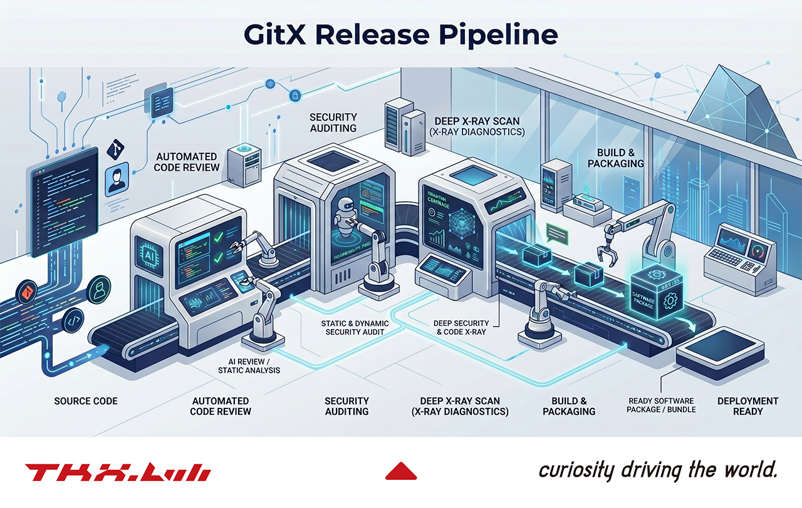
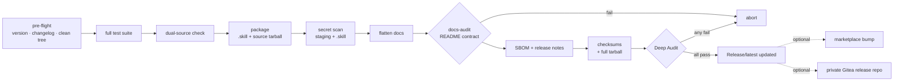

<!-- Hero image docs/assets/release-demo.jpeg is hand-maintained, not generated. Regions marked gitx:managed are regenerated by scripts/docs-pipeline.sh. -->
<div align="center">

# 🚀 GitX

**A fail-closed release pipeline for agent skills — every release rule is a shell assertion that stops the build.**

Most release incidents are not code bugs. They are a version bumped in one file but not another, a README that no longer matches the code, a token that slipped into a public archive, a tarball nobody can rebuild. GitX turns the release checklist into one local command that refuses to finish until every check passes. It ships any `skills/<name>/SKILL.md` project to four agent CLIs, and GitX itself is released with GitX.

[English](README.md) · [中文](README_CN.md)

<p align="center">
  
</p>

<!-- gitx:managed:badges -->
[](LICENSE)
[](tests/run_all.sh)
[](scripts/release-audit.sh)
[](#quick-start)
[](SKILL.md)
[](https://github.com/tkxlab-ai/GitX/releases)
[](docs/JOURNEY.md)
<!-- /gitx:managed:badges -->

</div>

<!-- gitx:managed:build-metrics -->
> 🛠 **Build metrics** — Version **v1.13.1** · Released **2026-11-13** · Engineered with **Claude (Opus/Sonnet) · Codex · Gemini** across hundreds of sessions · Cumulative AI tokens since the first prototype (v0.9.4, 2026-04-22), estimated: **≈ 300M+ input/output + ≈ 3B+ cached**
<!-- /gitx:managed:build-metrics -->

**[Documentation](#table-of-contents) · [Changelog](CHANGELOG.md) · [Report a bug](https://github.com/tkxlab-ai/GitX/issues) · [Security](SECURITY.md)**

---

## What's New

<!-- gitx:managed:whats-new -->
**v1.13.1 — 2026-11-13**

- README rewritten in English and Chinese around one storyline: a table of release failures and the gate that stops each, design principles mapped to their sources and to the code that enforces them, a pipeline diagram, and a table of what a release contains. The README now has 15 sections instead of 24; development history, review process, model collaboration and plans moved to `docs/JOURNEY.md`, internals to `docs/ARCHITECTURE.md`.
- The README section contract (`references/docs-contract/manifest.txt`) follows the new structure, and the `Philosophy` heading is known to `docs-audit` and `docs-pipeline`.
- `docs-audit` rule H11: a README must not cite the maintainers' private records (Gotcha / Dev Log / Decision numbers or handoff files), because readers cannot open them. A project whose product legitimately names such a file can exempt it with an `h11_allow:` line in the docs-contract manifest.
- GitHub issue forms (bug report, feature request), an issue chooser that routes security reports to private advisories, and a pull-request checklist.
- The README no longer carries hand-written release counts or spans, which had already gone stale, and the status badge no longer links to a removed section.
- README claims now match the code: the core pipeline never pushes, while the two optional post-release steps do write to a remote; a dry run performs read-only checks only; public CI runs shellcheck and an installer dry run.
<!-- /gitx:managed:whats-new -->

Full history → [`CHANGELOG.md`](CHANGELOG.md).

---

## Table of Contents

1. [Why GitX](#why-gitx)
2. [Philosophy](#philosophy)
3. [Pipeline & Audit Gates](#pipeline--audit-gates)
4. [Quick Start](#quick-start)
5. [Command Surface](#command-surface)
6. [Configuration](#configuration)
7. [Testing](#testing)
8. [Security](#security)
9. [Compatibility](#compatibility)
10. [FAQ](#faq)
11. [Research & References](#research--references)
12. [Contributing](#contributing)
13. [License](#license)

---

## Why GitX

A release is a checklist, and every item on it can be skipped by accident. Each skipped item becomes an incident later:

| Release step | What goes wrong without a gate | How GitX stops it |
|---|---|---|
| Version bump | the version file and the version being released disagree | the pre-flight stage aborts unless `VERSION` equals the release version |
| Changelog | the release ships with a missing or placeholder entry | the changelog gate requires a real entry for this exact version |
| Tests | "it passed on my machine last week" | the full suite runs again inside the pipeline; one failure aborts |
| Packaging | the bundle users install is not the tree that was tested | `scripts/` and the bundled copy must be byte-identical |
| Secrets | a token or a home-directory path lands in the public archive | a scanner checks the staging tree and the unpacked `.skill` for credentials, user paths, emails, public IPs, MAC addresses and key fingerprints |
| Docs | README numbers and sections drift away from the code | generated README regions are compared with the code; drift fails the release |
| Integrity | nobody can tell whether a download was altered | `checksums.txt` covers every shipped file; `install.sh` verifies it when installing from a release download |
| Publishing | private hostnames or working notes leak into the public mirror | private working files are excluded at every packaging layer and audited afterwards |

**Policy as code.** The release contract lives in [`references/TKX_Git_Release_policy_and_process.md`](references/TKX_Git_Release_policy_and_process.md). Its rules are enforced by scripts, not by a reviewer's memory: a violated rule aborts the build, and the few advisory checks that only warn are marked ⚠️. After packaging, a Deep Audit re-checks the finished release and reports every check as pass, fail or skip (the current total is in the badge above).

**Where it fits.** Tools such as semantic-release, release-please and goreleaser automate versioning and publishing in CI. GitX is the local layer before that: it targets skill and agent packaging, needs no CI runtime, and its core pipeline never pushes anything.

<sub>[↑ back to top](#table-of-contents)</sub>

---

## Philosophy

Every principle below comes from established engineering practice, and each one maps to code you can read.

| Principle | Source | Where GitX enforces it |
|---|---|---|
| **Fail closed** | Saltzer & Schroeder, *The Protection of Information in Computer Systems* (1975) — fail-safe defaults | any failed stage aborts the release; a check that cannot run is reported as ➖ skip and counted, never shown as a pass |
| **Policy as code** | compliance-as-code practice | the policy's rules are assertions in the release scripts (`release.sh`, `release-audit.sh`, `docs-audit.sh`, `release-sanitize.sh`); the few steps that stay manual are written as runbooks |
| **Reproducible builds** | [reproducible-builds.org](https://reproducible-builds.org/) | the source tarball is built with normalized timestamps and sorted entries |
| **Verifiable artifacts** | [SLSA](https://slsa.dev/) supply-chain goals · [CycloneDX](https://cyclonedx.org/) SBOM | `checksums.txt` verified by `install.sh` for release downloads; an SBOM ships with every release |
| **Readable history** | [Semantic Versioning 2.0.0](https://semver.org/) · [Keep a Changelog](https://keepachangelog.com/) | the changelog gate; English and Chinese changelogs held to the same structure |
| **Deterministic docs** | the projen / terraform-docs generator lineage | README regions are regenerated from the code and a `--check` mode fails on drift; no LLM sits in that loop |
| **Test first** | Kent Beck, *Test-Driven Development: By Example* (2002) | every gate has a test that proves it fires, using deliberately hostile fixtures |

Three working rules follow from these:

- **Generic-safe.** GitX releases other projects too. When a project lacks a file or tool that a check needs, the check skips instead of failing a project for something it never opted into.
- **No automatic upstream writes by default.** The core pipeline never pushes, tags or publishes. Publishing to GitHub is done by a person, or by an agent on that person's explicit instruction, following a generated runbook. The two optional post-release steps below write to a remote only on a machine where their switch file exists.
- **Self-hosting.** GitX is released through its own pipeline, so every rule it imposes on other projects is exercised on itself first.

<sub>[↑ back to top](#table-of-contents)</sub>

---

## Pipeline & Audit Gates

One command (`/gitx-release`) runs these stages in order. Any stage that fails stops the release. The pipeline writes only to `Release/` and to the version and changelog files.



### What a release contains

| Artifact | Produced by | Verified by |
|---|---|---|
| `<name>-vX.Y.Z.skill` | skill packaging | secret scan of its unpacked contents; Deep Audit |
| `<name>-vX.Y.Z-source.tar.gz` | reproducible tarball build | changelog parity check; secret scan |
| `<name>-vX.Y.Z-full.tar.gz` | full tarball build | its hash recorded in `checksums.txt` |
| `checksums.txt` | checksum stage | `install.sh` when installing from a release download; `shasum -a 256 -c` by anyone |
| `sbom.cyclonedx.json` | attestation stage | Deep Audit |
| `RELEASE_NOTES.md` · `TOKEN_USAGE.md` · `CHANGELOG.md` / `CHANGELOG_CN.md` | release-notes, attestation and changelog stages | Deep Audit; changelog parity check |
| flattened docs + `install.sh` | doc flattening | `docs-audit`; Deep Audit document gates |

### Audit gates

The Deep Audit is grouped into sections `§0`–`§0m` and `§1`–`§11`. Representative gates:

| Gate | Enforces |
|---|---|
| `§0b` | `INSTALL.md` and `install.sh` follow the shared install standard |
| `§0c` / `§0d` | `gitx-init` / `gitx-sop` templates stay intact and generate-only |
| `§0f` | every Deep Audit count cited in the README agrees |
| `§0g` | generated README regions match the code |
| `§0i` | the cited count equals the live total |
| `§0j` | the same shellcheck command that GitHub CI runs |

Every audit check reports one of five states, each with a fixed meaning:

| Symbol | Meaning | Counts toward |
|---|---|---|
| ✅ | pass | PASS |
| ❌ | fail — aborts the release | FAIL |
| ➖ | skip — not applicable, or the tool is absent | SKIP |
| ⚠️ | warning — visible, does not block | not counted |
| ⛔ | gate the user must unlock deliberately | not counted |

`TOTAL = PASS + FAIL + SKIP` is itself checked, so adding a gate can never silently change the headline number.

### Optional post-release steps

Two steps run after a successful release only when a per-machine switch file exists in `.gitx/`. Both are best-effort: a failure prints a warning and never changes the release result. They are the only steps that write to a remote.

| Switch file | Step |
|---|---|
| `.gitx/marketplace-target` | bump this skill's version in the central plugin marketplace (branch, PR, merge) |
| `.gitx/gitea-release-target` | publish the release directory to a private Gitea release repository (`main` + tag + Release with assets) |

The internals — file layout, the dual-source rule, how each stage is implemented — are in [`docs/ARCHITECTURE.md`](docs/ARCHITECTURE.md).

<sub>[↑ back to top](#table-of-contents)</sub>

---

## Quick Start

### 1 · Prerequisites

Bash 3.2+ (the macOS system bash works), git 2.x, and the standard tools `rsync`, `tar`, `gzip`, `unzip` and `shasum` (or `sha256sum`). Optional: `python3` with `venv` (skill validation bootstraps its own copy); `jq` and `gh` for the marketplace step.

### 2 · Install — two ways

*Option A — plugin marketplace (Claude Code plugin users):*
```text
/plugin marketplace add tkxlab-ai/marketplace
/plugin install gitx@tkx-skills
```

*Option B — `install.sh` (one command covers all four CLIs, no plugin system needed):*
```bash
git clone https://github.com/tkxlab-ai/GitX.git && cd GitX
bash install.sh             # installs to ~/.agents/skills/gitx-release, links Claude Code and OpenCode;
                            # Codex and Gemini discover it automatically
bash install.sh --dry-run   # show every action, change nothing
bash install.sh --force     # reinstall over an existing copy (overwrites installed command files)
```

### 3 · Release a skill project
```bash
cd your-skill-project
/gitx-release                   # bump the patch version and run the whole pipeline
/gitx-release --version v1.2.0  # or name the version
```

<details>
<summary><b>What a release run looks like</b></summary>

```console
$ /gitx-release --version v1.2.0
▸ pre-flight ................ VERSION matches v1.2.0 · changelog entry present · clean tree
▸ test suite ................ all suites green
▸ dual-source check ......... scripts/ ≡ bundled copy
▸ package ................... .skill + source tarball
▸ secret scan ............... staging tree and .skill clean
▸ docs-audit ................ README contract clean
▸ attestations .............. SBOM + release notes
▸ checksums ................. checksums.txt + full tarball
▸ Deep Audit ................ all checks pass, 0 fail
RELEASE READY · nothing pushed
```

</details>

### 4 · Prepare a new project

`/gitx-init` writes the release policy pack into the project; `/gitx-sop` renders the step-by-step runbook for publishing to GitHub. Both only generate files; they never run git or gh.

<details>
<summary><b>Install troubleshooting</b></summary>

If `/plugin install gitx@tkx-skills` fails with `Host key verification failed` or `No ED25519 host key is known for github.com`, your git is rewriting HTTPS clones to SSH. That is a local git setting, and it affects every GitHub HTTPS clone on the machine. Pick one fix:

1. **Remove the rewrite** (recommended). List rewrites with `git config --global --get-regexp 'url\..*insteadof'`, then `--unset` the `url.<base>.insteadOf` entry that maps `https://github.com/` to SSH.
2. **Keep SSH and fix host verification.** Check the key against [GitHub's published SSH fingerprints](https://docs.github.com/en/authentication/keeping-your-account-and-data-secure/githubs-ssh-key-fingerprints), or route SSH over port 443 in `~/.ssh/config` (`Host github.com` → `Hostname ssh.github.com`, `Port 443`, `User git`).
3. **Skip git entirely.** `curl -fsSL https://github.com/tkxlab-ai/GitX/archive/refs/heads/main.tar.gz | tar xz`, then `cd GitX-main && ./install.sh`.

</details>

<sub>[↑ back to top](#table-of-contents)</sub>

---

## Command Surface

<!-- gitx:managed:command-surface -->
Two install paths.

**A. install.sh** — run `bash install.sh` (skill + flat commands; no plugin needed)

- `/gitx-release` — the skill itself
- `/gitx-init`
- `/gitx-marketplace`
- `/gitx-sop`

**B. Plugin marketplace** — `/plugin marketplace add tkxlab-ai/marketplace` then `/plugin install gitx@tkx-skills` (`/gitx` colon namespace)

- `/gitx:audit`
- `/gitx:init`
- `/gitx:release`
- `/gitx:scan`
- `/gitx:sop`

> The `/gitx` colon-prefixed commands are plugin-only (a plugin-namespacing design, per official docs). install.sh gives flat `/gitx-release` + `/<cmd>`; the colon form requires this plugin install and is NEVER synthesized from flat commands.
<!-- /gitx:managed:command-surface -->

<details>
<summary><b>Calling the scripts directly</b> (CI, debugging, single stages)</summary>

Slash commands are thin wrappers over these scripts:

| Script | Interface | Purpose |
|---|---|---|
| `scripts/gitx-release.sh` | `[--dry-run] [--version vX.Y.Z] [--skip-marketplace] [--skip-gitea-release]` | entry point: sets up the log, runs the pipeline, then the optional post-release steps |
| `scripts/release.sh` | `PROJECT_ROOT=<dir> … <version> [--dry-run]` | the pipeline stages themselves |
| `scripts/release-audit.sh` | `<version>` | run the Deep Audit on an existing release |
| `scripts/release-sanitize.sh` | `[--label <name>] <dir>` | scan a directory for secrets and personal data |
| `scripts/scan-credentials.sh` | `[file]` or stdin | detect plaintext credentials in one file |
| `scripts/docs-pipeline.sh` | `[--locale en\|cn] [--check] [--init] [--dry-run]` | regenerate or check the managed README regions |
| `scripts/docs-audit.sh` | — | check the README section contract (rules H1–H11) |
| `scripts/sync-dual-source.sh` | `[--dry-run]` | copy `scripts/` into the bundled skill copy |
| `scripts/gitx-marketplace.sh` | `register\|bump\|list` | manage this skill's entry in the central marketplace |
| `scripts/gitx-gitea-release.sh` | `[--dry-run] [--force] [--version vX.Y.Z]` | publish a release to a private Gitea release repository |

</details>

**Examples**

```bash
# Dry run: read-only checks only; writes nothing but a log under Release/logs/ (tests, scans and the audit are skipped)
PROJECT_ROOT="$(pwd)" bash ~/.agents/skills/gitx-release/scripts/gitx-release.sh --dry-run

# Re-audit a release that is already built
bash ~/.agents/skills/gitx-release/scripts/release-audit.sh v1.2.0

# Scan a directory for secrets before packaging anything
bash ~/.agents/skills/gitx-release/scripts/release-sanitize.sh ./dist
```

<sub>[↑ back to top](#table-of-contents)</sub>

---

## Configuration

No configuration is required: names and paths are derived from the project layout. Override only when a project differs from the convention.

| Variable | Default | Purpose |
|---|---|---|
| `PROJECT_ROOT` | `$(pwd)` | the project being released (holds `VERSION` and `SKILL.md`) |
| `PROJECT_NAME` | derived from the directory | prefix for artifact names |
| `SKILL_NAME` | the single `skills/<name>/` | which skill bundle to package |
| `SKILL_EXCLUDE_PATTERNS` | `*-workspace\|*-evals` | directories ignored when detecting the skill |

| File | Role |
|---|---|
| `VERSION` | the single source of the version number |
| `Release/CHANGELOG.md` · `Release/CHANGELOG_CN.md` | release history; the gate reads the top entry, the Chinese file mirrors its structure |
| `.sanitize-ignore` | files the secret scanner may skip (intentional test fixtures) |
| `references/docs-contract/manifest.txt` | the README section contract that `docs-audit` enforces |
| `.gitx/*` | per-machine switches for the optional post-release steps (never committed) |

<sub>[↑ back to top](#table-of-contents)</sub>

---

## Testing

Pure-bash test harness with no external test framework. `bash tests/run_all.sh` runs everything, and the pipeline runs it again as a release gate. Each suite runs in a clean environment with its own temp directory and is judged by its own summary line, so a suite that silently runs nothing counts as a failure.

Suites in the tree (machine-counted):

<!-- gitx:managed:suite-count -->
121
<!-- /gitx:managed:suite-count -->

| Area | What the suites lock down |
|---|---|
| Audit gates | three-state counting, the exactness check, skip discipline |
| Secrets | true positives and true negatives, the ignore list, fixtures that must stay exempt |
| Packaging | `scripts/` equals the bundled copy; template copies stay identical |
| Changelog and version | entry extraction, version matching including two-digit minors |
| Docs | README numbers, managed-region regeneration, drift detection |
| Install | path resolution, dry-run changes nothing |
| Private files | working notes and machine-local files never reach an artifact |

New behavior ships with a failing test first. The full suite runs in the development tree and again as a release gate. GitHub CI (Ubuntu) runs shellcheck and an installer dry run on every push; the public repository carries the release layout, so the suite itself runs before publishing rather than in public CI. macOS with its bash 3.2 is the primary development platform.

<sub>[↑ back to top](#table-of-contents)</sub>

---

## Security

GitX's threat model is a release tool's: **leaking what should stay private** and **shipping what was not verified**.

- **Private working files never reach a public artifact.** They are excluded from git, from the scanner's scope, from the packaging copy, and checked again by the audit after packaging.
- **No automatic upstream writes by default.** Pushing, tagging and publishing a GitHub Release are done by a person, or by an agent on that person's explicit instruction, following a generated runbook. The optional post-release steps write to a remote only where their switch file exists.
- **The secret scan fails closed.** It honors the explicit ignore list, so it cannot fail on its own test fixtures, yet it aborts on any real credential. It runs again on the exact tree that will be published.
- **Verifiable downloads.** Reproducible source tarball, CycloneDX SBOM, and `checksums.txt` that `install.sh` verifies before it trusts a downloaded bundle.

Report vulnerabilities privately as described in [`SECURITY.md`](SECURITY.md), not in a public issue.

<sub>[↑ back to top](#table-of-contents)</sub>

---

## Compatibility

| Surface | Support |
|---|---|
| Shell | Bash 3.2+ (macOS system bash), POSIX userland (BSD and GNU) |
| OS | macOS (primary; full suite) · Linux with GNU userland (shellcheck and installer checks run on Ubuntu in CI) |
| Agent CLIs | Claude Code · Codex · OpenCode · Gemini — one install covers all four |
| Optional | `python3` with `venv` for skill validation (bootstrapped automatically) |

<sub>[↑ back to top](#table-of-contents)</sub>

---

## FAQ

<details><summary><b>Does GitX push to GitHub or create tags for me?</b></summary>

No. The core pipeline never pushes or tags, and publishing to GitHub stays manual by policy. GitX builds and verifies the release; `/gitx-sop` renders the runbook a person (or an agent on their instruction) follows to publish it.
</details>

<details><summary><b>Do I need CI?</b></summary>

No. GitX runs locally before anything is pushed. It also runs the same shellcheck command that GitHub CI runs, so a green pipeline predicts a green CI.
</details>

<details><summary><b>The release stopped. Why?</b></summary>

A gate failed, by design. Read the last `❌` line: a stale changelog entry, a difference between `scripts/` and the bundled copy, a real secret, a README number that no longer matches, or a shellcheck finding. Fix the cause and run again.
</details>

<details><summary><b>Why keep English and Chinese in separate files?</b></summary>

So both stay deterministic. Inline language markers break easily and translating at build time is not reproducible. Separate files plus a check that both have the same structure keep each one readable and verifiable.
</details>

<details><summary><b>Where are the development history and the review process?</b></summary>

In [`docs/JOURNEY.md`](docs/JOURNEY.md): how GitX grew from a prototype, how releases are reviewed, which models helped build it, and what is planned next.
</details>

<sub>[↑ back to top](#table-of-contents)</sub>

---

## Research & References

| Work | Author / source | Used for |
|---|---|---|
| *The Protection of Information in Computer Systems* (1975) | Jerome Saltzer & Michael Schroeder | fail-safe defaults: an unverified state is a failed state |
| *Test-Driven Development: By Example* (2002) | Kent Beck | every gate proven by a test that makes it fire |
| [Reproducible Builds](https://reproducible-builds.org/) | the Reproducible Builds project | deterministic source tarballs |
| [SLSA](https://slsa.dev/) | OpenSSF | the goal of verifiable, tamper-evident artifacts |
| [CycloneDX](https://cyclonedx.org/) | OWASP | the SBOM format shipped with each release |
| [Semantic Versioning 2.0.0](https://semver.org/) · [Keep a Changelog](https://keepachangelog.com/) | Tom Preston-Werner · Olivier Lacan | version numbers and the changelog gate |
| projen · terraform-docs · markdown-magic | open-source generators | managed README regions with a check mode |

**Behavioral contract:** [`references/TKX_Git_Release_policy_and_process.md`](references/TKX_Git_Release_policy_and_process.md) — the rules the scripts enforce.

**Further reading:** [`docs/ARCHITECTURE.md`](docs/ARCHITECTURE.md) (how it is built) · [`docs/JOURNEY.md`](docs/JOURNEY.md) (how it got here) · [`INSTALL.md`](INSTALL.md) (full install matrix).

**Acknowledgments.** Built with Claude (Opus / Sonnet), OpenAI Codex and Google Gemini, used as independent reviewers rather than autocomplete. Contact: TKXLAB.AI · [github.com/tkxlab-ai](https://github.com/tkxlab-ai).

<sub>[↑ back to top](#table-of-contents)</sub>

---

## Contributing

Pull requests are welcome. The pipeline is the review bar:

1. Fork and branch (`feat/<topic>`).
2. Write the failing test first.
3. Implement the smallest change; keep `scripts/` and the bundled copy identical (`bash scripts/sync-dual-source.sh`).
4. Make the gates green: `bash tests/run_all.sh`, `bash scripts/release-audit.sh <version>` with zero failures, and `scripts/docs-audit.sh` exiting 0.
5. Open the PR; CI (shellcheck and an installer dry run) must pass. The full suite is not run by public CI, so run it locally as in step 4.

See [`CONTRIBUTING.md`](CONTRIBUTING.md) for the full workflow, [`CODE_OF_CONDUCT.md`](CODE_OF_CONDUCT.md) for community expectations, and [`SECURITY.md`](SECURITY.md) for private vulnerability reports.

<sub>[↑ back to top](#table-of-contents)</sub>

---

## License

MIT © TKXLAB.AI — see [`LICENSE`](LICENSE). Free for personal and commercial use; a link back to the GitHub organization is appreciated.

---

<div align="center">

**[tkxlab-ai/GitX](https://github.com/tkxlab-ai/GitX)**

Local · fail-closed · no pushes from the core pipeline · released with itself

</div>
