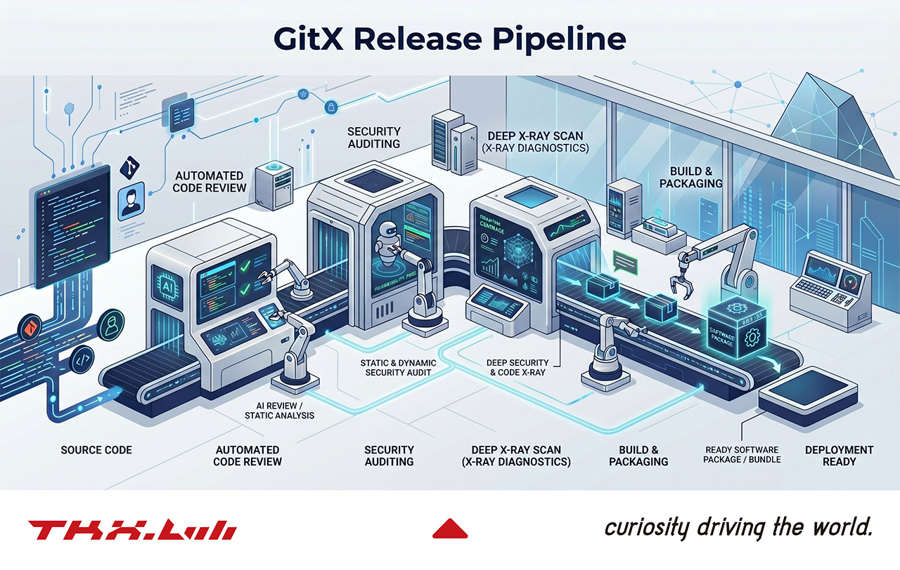
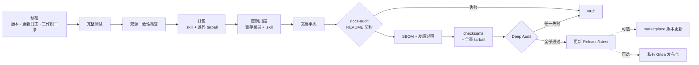

<!-- 首图 docs/assets/release-demo.jpeg 为人工维护，非流水线生成。标有 gitx:managed 的区块由 scripts/docs-pipeline.sh 重新生成。 -->
<div align="center">

# 🚀 GitX

**面向智能体技能的 fail-closed 发版流水线——每条发版规则都是一个会中止构建的 shell 断言。**

大多数发版事故并不是代码缺陷，而是：版本号改了一处漏了另一处、README 和代码对不上、令牌混进了公开归档、tarball 谁也重建不出来。GitX 把发版清单变成一条本地命令，任何一项检查没过，它就不会结束。它能把任何 `skills/<name>/SKILL.md` 项目发布到四个智能体 CLI，GitX 自己也用 GitX 发布。

[English](README.md) · [中文](README_CN.md)

<p align="center">
  
</p>

<!-- gitx:managed:badges -->
[](LICENSE)
[](tests/run_all.sh)
[](scripts/release-audit.sh)
[](#快速开始)
[](SKILL.md)
[](https://github.com/tkxlab-ai/GitX/releases)
[](docs/JOURNEY.md)
<!-- /gitx:managed:badges -->

</div>

<!-- gitx:managed:build-metrics -->
> 🛠 **构建指标** — 版本 **v1.13.1** · 发版日期 **2026-11-13** · 由 **Claude（Opus/Sonnet）· Codex · Gemini** 跨数百会话打造 · 自首个原型（v0.9.4，2026-04-22）起累计 AI token 估算：**≈ 3 亿+ 输入/输出 + ≈ 30 亿+ 缓存**
<!-- /gitx:managed:build-metrics -->

**[文档](#目录) · [更新日志](CHANGELOG_CN.md) · [报告缺陷](https://github.com/tkxlab-ai/GitX/issues) · [安全](SECURITY.md)**

---

## 更新摘要

<!-- gitx:managed:whats-new -->
**v1.13.1 — 2026-11-13**

- 中英文 README 按一条主线重写：一张"发版失误 → 拦住它的关卡"表、每条设计原则注明出处与落实它的代码、一张流水线图，以及"一次发版包含什么"的表。章节从 24 个减到 15 个；开发历程、评审流程、多模型协作和后续计划移到`docs/JOURNEY.md`，内部实现移到 `docs/ARCHITECTURE.md`。
- README 章节契约（`references/docs-contract/manifest.txt`）随新结构更新，`docs-audit` 与 `docs-pipeline` 认识新增的"设计理念"章节。
- `docs-audit` 新增 H11 规则：README 不得引用维护者的私有记录（坑位、开发日志、决策编号或交接文件），因为读者打不开它们。产品本身确实要提到此类文件名的项目，可在文档契约清单里用 `h11_allow:` 行豁免。
- GitHub 的缺陷报告与功能建议表单、把安全问题引导到私密通道的 issue 选择页，以及一份 PR 检查清单。
- README 不再写手工维护的版本总数和时间跨度（这些数字此前已经过时），状态徽章也不再链接到已删除的章节。
- README 的说法与代码对齐：核心流水线从不推送，但两个可选的发版后步骤会写远端；演练模式只做只读检查；公开 CI 运行 shellcheck 和安装器演练。
<!-- /gitx:managed:whats-new -->

完整历史 → [`CHANGELOG_CN.md`](CHANGELOG_CN.md)。

---

## 目录

1. [为什么选择 GitX](#为什么选择-gitx)
2. [设计理念](#设计理念)
3. [流水线与审计闸](#流水线与审计闸)
4. [快速开始](#快速开始)
5. [命令面](#命令面)
6. [配置](#配置)
7. [测试](#测试)
8. [安全](#安全)
9. [兼容性](#兼容性)
10. [常见问题](#常见问题)
11. [研究与参考](#研究与参考)
12. [贡献](#贡献)
13. [许可](#许可)

---

## 为什么选择 GitX

发版是一张清单，清单上的每一项都可能被无意跳过，而每一次跳过日后都会变成一次事故：

| 发版环节 | 没有关卡时会出什么错 | GitX 怎么拦住 |
|---|---|---|
| 版本号 | 版本文件与本次要发的版本不一致 | 除非 `VERSION` 等于本次发版版本，否则预检阶段中止 |
| 更新日志 | 发出去的版本缺少条目，或只有占位文字 | 更新日志关卡要求本版本有一条真实条目 |
| 测试 | "上周在我机器上是过的" | 流水线内重新跑完整测试，失败一个就中止 |
| 打包 | 用户装到的包不是测试过的那份代码 | `scripts/` 与包内副本必须逐字节一致 |
| 密钥 | 令牌或家目录路径进了公开归档 | 扫描暂存目录和解压后的 `.skill`：凭证、用户路径、邮箱、公网 IP、MAC 地址、密钥指纹 |
| 文档 | README 里的数字和章节逐渐与代码脱节 | 自动生成的 README 区块与代码比对，有偏差即发版失败 |
| 完整性 | 没人能判断下载的文件是否被改过 | `checksums.txt` 覆盖每个出货文件，从发布包安装时 `install.sh` 会先校验 |
| 公开发布 | 私有主机名或工作笔记漏进公开镜像 | 私有工作文件在每一层打包时排除，打包后再审计一次 |

**政策即代码。** 发版契约写在 [`references/TKX_Git_Release_policy_and_process.md`](references/TKX_Git_Release_policy_and_process.md)。这些规则由脚本强制执行，而不是靠审阅者记得：违反规则会直接中止构建，少数只做提醒的检查标为 ⚠️。打包完成后，Deep Audit 对成品重新逐项检查，每项结果是通过、失败或跳过三者之一（当前总数见上方徽章）。

**定位。** semantic-release、release-please、goreleaser 这类工具在 CI 里自动处理版本号和发布。GitX 是在那之前的本地一层：面向技能与智能体的打包，不需要 CI 运行环境，核心流水线也从不推送任何东西。

<sub>[↑ 回到顶部](#目录)</sub>

---

## 设计理念

下面每条原则都来自成熟的工程实践，并且都能在代码里找到落点。

| 原则 | 出处 | GitX 在哪里落实 |
|---|---|---|
| **默认失败关闭** | Saltzer 与 Schroeder《计算机系统中的信息保护》（1975），"失败安全的默认值" | 任何阶段失败都中止发版；无法执行的检查记为 ➖ 跳过并计数，绝不显示为通过 |
| **政策即代码** | 合规即代码的实践 | 政策的规则都是发版脚本（`release.sh`、`release-audit.sh`、`docs-audit.sh`、`release-sanitize.sh`）里的断言；少数保持手动的步骤写成了操作手册 |
| **可复现构建** | [reproducible-builds.org](https://reproducible-builds.org/) | 源码 tarball 统一时间戳、条目排序后打包 |
| **可验证的产物** | [SLSA](https://slsa.dev/) 供应链目标 · [CycloneDX](https://cyclonedx.org/) SBOM | 从发布包安装时 `install.sh` 校验 `checksums.txt`；每次发版附带 SBOM |
| **可读的历史** | [语义化版本 2.0.0](https://semver.org/lang/zh-CN/) · [Keep a Changelog](https://keepachangelog.com/zh-CN/) | 更新日志关卡；中英文更新日志保持相同结构 |
| **确定性文档** | projen / terraform-docs 这一类生成器 | README 区块由代码重新生成，`--check` 模式发现偏差即失败；这个环节里没有 LLM |
| **测试先行** | Kent Beck《测试驱动开发》（2002） | 每道关卡都有一个证明它会触发的测试，夹具故意设计成"有敌意"的 |

由此得出三条工作规则：

- **通用安全。** GitX 也为别的项目发版。如果某个项目缺少某项检查需要的文件或工具，这项检查会跳过，而不是让项目因为它从未启用的东西失败。
- **默认不写上游。** 核心流水线从不推送、打 tag 或发布。发布到 GitHub 由人执行，或由智能体在人明确指示后执行，依据是生成好的操作手册。下文两个可选的发版后步骤，只有在存在对应开关文件的机器上才会写远端。
- **用自己发布自己。** GitX 用自己的流水线发版，所以它对别的项目提出的每条规则，都先在自己身上跑过。

<sub>[↑ 回到顶部](#目录)</sub>

---

## 流水线与审计闸

一条命令（`/gitx-release`）按顺序执行以下阶段。任何阶段失败都会停止发版。流水线只写入 `Release/` 以及版本号和更新日志文件。



### 一次发版包含什么

| 产物 | 由哪一步生成 | 由什么验证 |
|---|---|---|
| `<name>-vX.Y.Z.skill` | 技能打包 | 解压后做密钥扫描；Deep Audit |
| `<name>-vX.Y.Z-source.tar.gz` | 可复现 tarball 构建 | 更新日志一致性检查；密钥扫描 |
| `<name>-vX.Y.Z-full.tar.gz` | 全量 tarball 构建 | 其哈希记入 `checksums.txt` |
| `checksums.txt` | 校验和阶段 | 从发布包安装时由 `install.sh` 校验；任何人可用 `shasum -a 256 -c` 核对 |
| `sbom.cyclonedx.json` | 证明材料阶段 | Deep Audit |
| `RELEASE_NOTES.md` · `TOKEN_USAGE.md` · `CHANGELOG.md` / `CHANGELOG_CN.md` | 发版说明、证明材料与更新日志阶段 | Deep Audit；更新日志一致性检查 |
| 平摊文档 + `install.sh` | 文档平摊 | `docs-audit`；Deep Audit 文档关卡 |

### 审计关卡

Deep Audit 分为 `§0`–`§0m` 和 `§1`–`§11` 各节。代表性关卡：

| 关卡 | 强制什么 |
|---|---|
| `§0b` | `INSTALL.md` 与 `install.sh` 遵守统一的安装标准 |
| `§0c` / `§0d` | `gitx-init` / `gitx-sop` 模板完整，且只生成不执行 |
| `§0f` | README 里引用的 Deep Audit 计数彼此一致 |
| `§0g` | 自动生成的 README 区块与代码一致 |
| `§0i` | 引用的计数等于实际总数 |
| `§0j` | 与 GitHub CI 完全相同的 shellcheck 命令 |

每项审计检查只报告五种状态之一，含义固定：

| 符号 | 含义 | 计入 |
|---|---|---|
| ✅ | 通过 | PASS |
| ❌ | 失败——中止发版 | FAIL |
| ➖ | 跳过——不适用，或缺少工具 | SKIP |
| ⚠️ | 警告——可见，但不阻塞 | 不计数 |
| ⛔ | 需要用户主动解锁的关卡 | 不计数 |

`TOTAL = PASS + FAIL + SKIP` 本身也受检查，所以新增关卡不会悄悄改变对外公布的总数。

### 可选的发版后步骤

只有当本机 `.gitx/` 里存在对应的开关文件时，发版成功后才会执行这两步。两者都是尽力而为：失败只打印警告，不改变发版结果。只有这两步会写远端。

| 开关文件 | 步骤 |
|---|---|
| `.gitx/marketplace-target` | 在中央插件 marketplace 里更新本技能的版本（建分支、提 PR、合并） |
| `.gitx/gitea-release-target` | 把发版目录发布到私有 Gitea 发布仓（`main` + tag + 带附件的 Release） |

内部实现——文件布局、双源规则、每个阶段怎么实现——见 [`docs/ARCHITECTURE.md`](docs/ARCHITECTURE.md)（英文）。

<sub>[↑ 回到顶部](#目录)</sub>

---

## 快速开始

### 1 · 前置条件

Bash 3.2+（macOS 自带的 bash 即可）、git 2.x，以及常用工具 `rsync`、`tar`、`gzip`、`unzip` 和 `shasum`（或 `sha256sum`）。可选：带 `venv` 的 `python3`（技能校验会自动准备自己的副本）；marketplace 步骤需要 `jq` 和 `gh`。

### 2 · 安装——两种方式

*方式 A——插件 marketplace（Claude Code 插件用户）：*
```text
/plugin marketplace add tkxlab-ai/marketplace
/plugin install gitx@tkx-skills
```

*方式 B——`install.sh`（一条命令覆盖四个 CLI，不需要插件系统）：*
```bash
git clone https://github.com/tkxlab-ai/GitX.git && cd GitX
bash install.sh             # 安装到 ~/.agents/skills/gitx-release，并为 Claude Code 和 OpenCode 建链接；
                            # Codex 与 Gemini 自动发现
bash install.sh --dry-run   # 列出每个动作，不做任何修改
bash install.sh --force     # 覆盖已有安装（会覆盖已安装的命令文件）
```

### 3 · 为技能项目发版
```bash
cd your-skill-project
/gitx-release                   # 自动递增补丁版本号并跑完整条流水线
/gitx-release --version v1.2.0  # 或指定版本号
```

<details>
<summary><b>一次发版运行时的样子</b></summary>

```console
$ /gitx-release --version v1.2.0
▸ pre-flight ................ VERSION matches v1.2.0 · changelog entry present · clean tree
▸ test suite ................ all suites green
▸ dual-source check ......... scripts/ ≡ bundled copy
▸ package ................... .skill + source tarball
▸ secret scan ............... staging tree and .skill clean
▸ docs-audit ................ README contract clean
▸ attestations .............. SBOM + release notes
▸ checksums ................. checksums.txt + full tarball
▸ Deep Audit ................ all checks pass, 0 fail
RELEASE READY · nothing pushed
```

</details>

### 4 · 让新项目学会发版

`/gitx-init` 把发版政策包写进项目；`/gitx-sop` 生成发布到 GitHub 的逐步操作手册。两者都只生成文件，从不执行 git 或 gh。

<details>
<summary><b>安装排错</b></summary>

如果 `/plugin install gitx@tkx-skills` 报 `Host key verification failed` 或 `No ED25519 host key is known for github.com`，说明你的 git 把 HTTPS 克隆改写成了 SSH。这是本机的 git 配置，会影响这台机器上所有 GitHub 的 HTTPS 克隆。任选一种修法：

1. **去掉改写规则**（推荐）。用 `git config --global --get-regexp 'url\..*insteadof'` 列出改写规则，再对把 `https://github.com/` 改成 SSH 的那条 `url.<base>.insteadOf` 执行 `--unset`。
2. **保留 SSH，修好主机校验。** 对照 [GitHub 公布的 SSH 指纹](https://docs.github.com/zh/authentication/keeping-your-account-and-data-secure/githubs-ssh-key-fingerprints)核对密钥，或在 `~/.ssh/config` 里让 SSH 走 443 端口（`Host github.com` → `Hostname ssh.github.com`、`Port 443`、`User git`）。
3. **完全绕开 git。** `curl -fsSL https://github.com/tkxlab-ai/GitX/archive/refs/heads/main.tar.gz | tar xz`，然后 `cd GitX-main && ./install.sh`。

</details>

<sub>[↑ 回到顶部](#目录)</sub>

---

## 命令面

<!-- gitx:managed:command-surface -->
两种安装路径。

**A. install.sh** — 运行 `bash install.sh`（技能 + 扁平命令；无需插件）

- `/gitx-release` — 技能本体
- `/gitx-init`
- `/gitx-marketplace`
- `/gitx-sop`

**B. 插件市场** — `/plugin marketplace add tkxlab-ai/marketplace` 然后 `/plugin install gitx@tkx-skills`（`/gitx` 冒号命名空间）

- `/gitx:audit`
- `/gitx:init`
- `/gitx:release`
- `/gitx:scan`
- `/gitx:sop`

> `/gitx` 冒号前缀命令仅限插件（官方文档的插件命名空间设计）。install.sh 提供扁平 `/gitx-release` + `/<cmd>`；冒号形式需要安装此插件，从不由扁平命令合成。
<!-- /gitx:managed:command-surface -->

<details>
<summary><b>直接调用脚本</b>（CI、调试、单独执行某个阶段）</summary>

斜杠命令只是这些脚本的薄封装：

| 脚本 | 接口 | 用途 |
|---|---|---|
| `scripts/gitx-release.sh` | `[--dry-run] [--version vX.Y.Z] [--skip-marketplace] [--skip-gitea-release]` | 入口：准备日志、跑流水线，再执行可选的发版后步骤 |
| `scripts/release.sh` | `PROJECT_ROOT=<dir> … <version> [--dry-run]` | 流水线各阶段本身 |
| `scripts/release-audit.sh` | `<version>` | 对已有的发版目录跑 Deep Audit |
| `scripts/release-sanitize.sh` | `[--label <name>] <dir>` | 扫描目录中的密钥和个人信息 |
| `scripts/scan-credentials.sh` | `[file]` 或标准输入 | 检测单个文件里的明文凭证 |
| `scripts/docs-pipeline.sh` | `[--locale en\|cn] [--check] [--init] [--dry-run]` | 重新生成或检查 README 的自动区块 |
| `scripts/docs-audit.sh` | — | 检查 README 章节契约（规则 H1–H11） |
| `scripts/sync-dual-source.sh` | `[--dry-run]` | 把 `scripts/` 同步到包内的技能副本 |
| `scripts/gitx-marketplace.sh` | `register\|bump\|list` | 管理本技能在中央 marketplace 里的条目 |
| `scripts/gitx-gitea-release.sh` | `[--dry-run] [--force] [--version vX.Y.Z]` | 把发版发布到私有 Gitea 发布仓 |

</details>

**示例**

```bash
# 演练模式：只做只读检查，除 Release/logs/ 下的日志外不写任何文件（测试、扫描和审计都会跳过）
PROJECT_ROOT="$(pwd)" bash ~/.agents/skills/gitx-release/scripts/gitx-release.sh --dry-run

# 对已经构建好的发版重新审计
bash ~/.agents/skills/gitx-release/scripts/release-audit.sh v1.2.0

# 打包之前先扫描目录里的密钥
bash ~/.agents/skills/gitx-release/scripts/release-sanitize.sh ./dist
```

<sub>[↑ 回到顶部](#目录)</sub>

---

## 配置

不需要任何配置：名称和路径都从项目结构推导。只有项目结构与约定不同时才需要覆盖。

| 变量 | 默认值 | 用途 |
|---|---|---|
| `PROJECT_ROOT` | `$(pwd)` | 要发版的项目（含 `VERSION` 与 `SKILL.md`） |
| `PROJECT_NAME` | 由目录名推导 | 产物文件名前缀 |
| `SKILL_NAME` | 唯一的 `skills/<name>/` | 要打包的技能 |
| `SKILL_EXCLUDE_PATTERNS` | `*-workspace\|*-evals` | 识别技能时忽略的目录 |

| 文件 | 作用 |
|---|---|
| `VERSION` | 版本号的唯一来源 |
| `Release/CHANGELOG.md` · `Release/CHANGELOG_CN.md` | 发版历史；关卡读取最上面一条，中文文件与英文保持相同结构 |
| `.sanitize-ignore` | 密钥扫描可以跳过的文件（有意设计的测试夹具） |
| `references/docs-contract/manifest.txt` | `docs-audit` 强制执行的 README 章节契约 |
| `.gitx/*` | 本机专用的发版后步骤开关（从不提交） |

<sub>[↑ 回到顶部](#目录)</sub>

---

## 测试

纯 bash 测试框架，不依赖外部测试库。`bash tests/run_all.sh` 跑全部测试，流水线发版时还会作为关卡再跑一遍。每个套件在干净环境、独立临时目录中运行，并按它自己的汇总行判定结果，所以一个"什么都没跑"的套件会被判为失败。

仓库中的测试套件数（机器统计）：

<!-- gitx:managed:suite-count -->
121
<!-- /gitx:managed:suite-count -->

| 范围 | 这些套件锁定什么 |
|---|---|
| 审计关卡 | 三态计数、精确性检查、跳过规则 |
| 密钥 | 真阳性与真阴性、忽略清单、必须保持豁免的夹具 |
| 打包 | `scripts/` 与包内副本一致；模板副本保持一致 |
| 更新日志与版本 | 条目提取、版本匹配（包括两位数的次版本号） |
| 文档 | README 数字、自动区块重新生成、偏差检测 |
| 安装 | 路径解析、演练模式不做任何修改 |
| 私有文件 | 工作笔记和本机文件绝不进入任何产物 |

新行为一律先写失败的测试再实现。完整测试在开发树里运行，发版时作为关卡再跑一遍。GitHub CI（Ubuntu）对每次推送运行 shellcheck 和一次安装器演练；公开仓库是发布产物的布局，所以完整测试在发布之前跑，而不在公开 CI 里跑。带 bash 3.2 的 macOS 是主要开发平台。

<sub>[↑ 回到顶部](#目录)</sub>

---

## 安全

GitX 作为发版工具，威胁模型是两件事：**泄露本应私有的东西**，以及**发出没有验证过的东西**。

- **私有工作文件绝不进入公开产物。** 它们被排除在 git 之外、扫描范围之外、打包副本之外，打包后还会被审计再查一次。
- **默认不写上游。** 推送、打 tag、发布 GitHub Release 都由人执行，或由智能体在人明确指示后执行，依据是生成的操作手册。可选的发版后步骤只在存在开关文件的地方才写远端。
- **密钥扫描默认失败关闭。** 它遵守明确的忽略清单，因此不会被自己的测试夹具误判失败，但遇到任何真实凭证都会中止；并且会对即将公开的那份目录再扫一次。
- **下载可验证。** 可复现的源码 tarball、CycloneDX SBOM，以及 `install.sh` 在信任下载的安装包之前必先校验的 `checksums.txt`。

漏洞请按 [`SECURITY.md`](SECURITY.md) 私下报告，不要开公开 issue。

<sub>[↑ 回到顶部](#目录)</sub>

---

## 兼容性

| 层面 | 支持情况 |
|---|---|
| Shell | Bash 3.2+（macOS 自带 bash），POSIX 工具（BSD 与 GNU 均可） |
| 操作系统 | macOS（主平台，跑完整测试）· 使用 GNU 工具的 Linux（CI 在 Ubuntu 上运行 shellcheck 和安装器检查） |
| 智能体 CLI | Claude Code · Codex · OpenCode · Gemini——一次安装覆盖全部四个 |
| 可选 | 带 `venv` 的 `python3`，用于技能校验（自动准备） |

<sub>[↑ 回到顶部](#目录)</sub>

---

## 常见问题

<details><summary><b>GitX 会替我推送到 GitHub 或打 tag 吗？</b></summary>

不会。核心流水线从不推送或打 tag，发布到 GitHub 按政策保持手动。GitX 负责构建和验证发版；`/gitx-sop` 生成操作手册，由人（或人明确指示的智能体）照着发布。
</details>

<details><summary><b>需要 CI 吗？</b></summary>

不需要。GitX 在推送之前于本地运行。它还会执行与 GitHub CI 完全相同的 shellcheck 命令，所以流水线全绿基本意味着 CI 也会全绿。
</details>

<details><summary><b>发版中途停了，为什么？</b></summary>

有一道关卡失败了，这是设计如此。看最后一条 `❌`：可能是更新日志条目过期、`scripts/` 与包内副本不一致、真的有密钥、README 数字对不上，或者 shellcheck 报了问题。修好原因再跑一次。
</details>

<details><summary><b>为什么中英文分成两个文件？</b></summary>

为了让两者都保持确定性。行内的语言标记很容易坏，构建时翻译又无法复现。分成两个文件，再加上"两者结构相同"的检查，每个文件都可读、也可验证。
</details>

<details><summary><b>开发历程和评审流程在哪里？</b></summary>

在 [`docs/JOURNEY.md`](docs/JOURNEY.md)（英文）：GitX 如何从原型成长起来、发版如何评审、哪些模型参与了构建，以及接下来的计划。
</details>

<sub>[↑ 回到顶部](#目录)</sub>

---

## 研究与参考

| 作品 | 作者 / 来源 | 用在哪里 |
|---|---|---|
| 《计算机系统中的信息保护》（1975） | Jerome Saltzer、Michael Schroeder | 失败安全的默认值：未经验证的状态就是失败状态 |
| 《测试驱动开发》（2002） | Kent Beck | 每道关卡都由一个让它触发的测试来证明 |
| [Reproducible Builds](https://reproducible-builds.org/) | Reproducible Builds 项目 | 确定性的源码 tarball |
| [SLSA](https://slsa.dev/) | OpenSSF | 产物可验证、可发现篡改的目标 |
| [CycloneDX](https://cyclonedx.org/) | OWASP | 每次发版附带的 SBOM 格式 |
| [语义化版本 2.0.0](https://semver.org/lang/zh-CN/) · [Keep a Changelog](https://keepachangelog.com/zh-CN/) | Tom Preston-Werner · Olivier Lacan | 版本号规则与更新日志关卡 |
| projen · terraform-docs · markdown-magic | 开源生成器 | 带检查模式的 README 自动区块 |

**行为契约：** [`references/TKX_Git_Release_policy_and_process.md`](references/TKX_Git_Release_policy_and_process.md)——脚本强制执行的规则。

**延伸阅读：** [`docs/ARCHITECTURE.md`](docs/ARCHITECTURE.md)（怎么构建的）· [`docs/JOURNEY.md`](docs/JOURNEY.md)（怎么走到今天的）· [`INSTALL.md`](INSTALL.md)（完整安装矩阵）。以上为英文文档。

**鸣谢。** 由 Claude（Opus / Sonnet）、OpenAI Codex 与 Google Gemini 协作构建，它们被当作独立的评审者而不是自动补全。联系：TKXLAB.AI · [github.com/tkxlab-ai](https://github.com/tkxlab-ai)。

<sub>[↑ 回到顶部](#目录)</sub>

---

## 贡献

欢迎提交 PR。流水线本身就是评审标准：

1. Fork 后建分支（`feat/<topic>`）。
2. 先写会失败的测试。
3. 用最小改动实现；保持 `scripts/` 与包内副本一致（`bash scripts/sync-dual-source.sh`）。
4. 让关卡全绿：`bash tests/run_all.sh`、`bash scripts/release-audit.sh <version>` 零失败、`scripts/docs-audit.sh` 退出码为 0。
5. 提交 PR；CI（shellcheck 与安装器演练）必须通过。公开 CI 不跑完整测试，所以请按第 4 步先在本地跑。

完整流程见 [`CONTRIBUTING_CN.md`](CONTRIBUTING_CN.md)，社区约定见 [`CODE_OF_CONDUCT.md`](CODE_OF_CONDUCT.md)，私下报告漏洞见 [`SECURITY.md`](SECURITY.md)。

<sub>[↑ 回到顶部](#目录)</sub>

---

## 许可

MIT © TKXLAB.AI —— 见 [`LICENSE`](LICENSE)。个人与商业用途均免费；欢迎附上指向 GitHub 组织的链接。

---

<div align="center">

**[tkxlab-ai/GitX](https://github.com/tkxlab-ai/GitX)**

本地运行 · 默认失败关闭 · 核心流水线不推送 · 用自己发布自己

</div>
