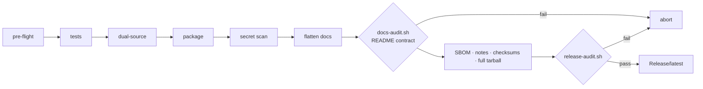

# GitX Architecture

How GitX is built: the file layout, the stages of a release, the rule that keeps the shipped bundle identical to the tested tree, and how private working files are kept out of every artifact. For what GitX does and why, start with the [README](../README.md).

---

## Repository layout

```
GitX/
├── SKILL.md                  agent instructions and trigger words
├── scripts/                  the pipeline (master copy)
│   ├── gitx-release.sh       entry point: log setup → release.sh → optional post-release steps
│   ├── release.sh            the release stages
│   ├── release-audit.sh      the Deep Audit
│   ├── release-sanitize.sh   secret / personal-data scanner
│   ├── docs-pipeline.sh      regenerates the managed README regions
│   └── docs-audit.sh         enforces the README section contract
├── skills/gitx-release/      the bundled copy users install (mirrors scripts/ and references/)
├── references/
│   ├── TKX_Git_Release_policy_and_process.md   the behavioral contract the scripts enforce
│   ├── readme/               README templates used by docs-pipeline --init
│   └── docs-contract/        the README section contract
├── tests/                    pure-bash suites with deliberately hostile fixtures
├── Release/CHANGELOG.md      English release history (source of truth)
└── Release/CHANGELOG_CN.md   Chinese history, same structure
```

---

## Release stages

`scripts/release.sh` runs these steps in a fixed order. Each one either succeeds or aborts the release. In `--dry-run` mode the read-only checks still run (tool and version pre-flight, the dual-source comparison, the README contract); every step that would test, write or audit only prints what it would do.

| # | Step | What it does |
|---|---|---|
| 1 | `preflight_external_tools` | checks that `rsync`, `tar`, `gzip`, `unzip`, `awk`, `sed`, `grep`, `find`, `diff` and a SHA-256 tool are installed |
| 2 | `preflight_checks` | version format, `skills/<name>/VERSION` equals the release version, `SKILL.md` frontmatter shape, changelog gate, clean working tree |
| 3 | `run_tests` | runs `tests/run_all.sh`; any failure aborts |
| 4 | `check_dual_source` | `scripts/` must be byte-identical to the bundled copy |
| 5 | `build_skill_package` | builds the `.skill` archive |
| 6 | `build_source_tarball` | stages the tree without git-ignored paths and writes a reproducible tarball (normalized timestamps, sorted entries) |
| 7 | `assert_changelog_tarball_parity` | the changelog inside the tarball equals `Release/CHANGELOG.md` byte for byte |
| 8 | `run_sanity_scans` | scans the staging tree, then the unpacked `.skill`, for secrets and personal data |
| 9 | `flatten_docs` | copies the documents, `scripts/`, `references/`, `assets/` and `install.sh` into the release directory |
| 10 | `docs-audit.sh` (inline gate) | the README contract, rules H1–H11; a violation aborts the release |
| 11 | `generate_attestations` | writes the CycloneDX SBOM and the token-usage report |
| 12 | `generate_release_notes` | writes `RELEASE_NOTES.md` with the install paths and this version's changelog entry |
| 13 | `update_changelog` | places the changelogs in the release directory |
| 14 | `generate_checksums` | writes `checksums.txt` over every shipped file |
| 15 | `build_full_tarball` | writes the full tarball and appends its hash to `checksums.txt` |
| 16 | `run_deep_audit` | runs `release-audit.sh` in inline mode; any failure aborts |
| 17 | `update_latest_symlink` | atomically points `Release/latest` at the new release |

After a successful release, `gitx-release.sh` runs two optional, best-effort steps when their per-machine switch files exist: the central marketplace bump (`.gitx/marketplace-target`: branch, PR, merge on the marketplace repository) and the private Gitea release repository (`.gitx/gitea-release-target`: push `main` and the tag, then create the Release). They are the only steps that write to a remote, and neither can change the release result.

---

## Two independent gates



- **`docs-audit.sh`** checks the README contract before anything is hashed: every declared section present and in order, the English and Chinese READMEs structurally identical, no long English runs in the Chinese file, every machine-generated number equal to the live value, every local link resolvable, and no references to private working files.
- **`release-audit.sh`** checks the finished release: install standard, template integrity, README count consistency (`§0f`) and exactness (`§0i`), generated-region drift (`§0g`), and the same shellcheck command GitHub CI runs (`§0j`).

---

## The dual-source rule

`scripts/` is the master copy; `skills/gitx-release/scripts/` is the copy users install. After any edit, `bash scripts/sync-dual-source.sh` copies master to mirror. The pipeline, CI and a dedicated test all fail on any difference, so the bundle a user installs is provably the tree that was tested.

The `references/readme/` and `references/docs-contract/` copies are held to the same rule by tests, with one deliberate exception: the bundled `manifest.txt` omits the `hero_asset` line, because the hero image belongs to this repository and must not be required of projects that install GitX.

---

## Keeping private files private

Working notes, handoff files, machine-local switches and planning documents live in the development tree but must never reach an artifact. They are excluded at every layer, and the exclusion lists are tested to stay in step:

| Layer | Mechanism |
|---|---|
| Version control | listed in `.gitignore` |
| Secret scanner | listed in `.sanitize-ignore`, so the scanner does not need to read them |
| Packaging | excluded by the staging copy in `build_source_tarball` |
| After packaging | the Deep Audit fails if any of them appears in the release |
| README | `docs-audit` rule H11 fails if the README cites one of them |

---

## Symbol and state system

Every audit check reports one of five states with a fixed meaning: ✅ pass, ❌ fail (aborts), ➖ skip (not applicable or tool absent, counted), ⚠️ warning (not counted), ⛔ gate the user must unlock deliberately. `TOTAL = PASS + FAIL + SKIP` is itself verified, so adding a check can never silently change the published total.

---

## Built with

Pure Bash 3.2+ with POSIX userland (BSD and GNU) — `awk`, `sed`, `grep`, `find`, `rsync`, `tar`, `gzip`, `unzip`, `shasum` — plus shellcheck for linting and CycloneDX for the SBOM format. No language runtime is required.
